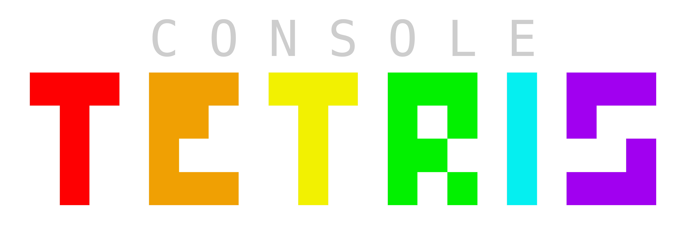
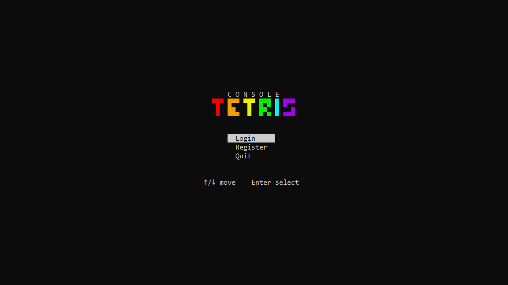
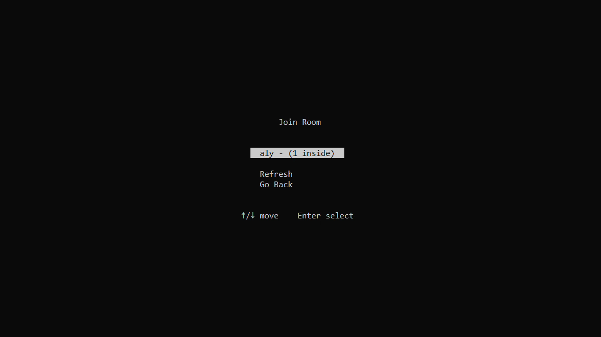
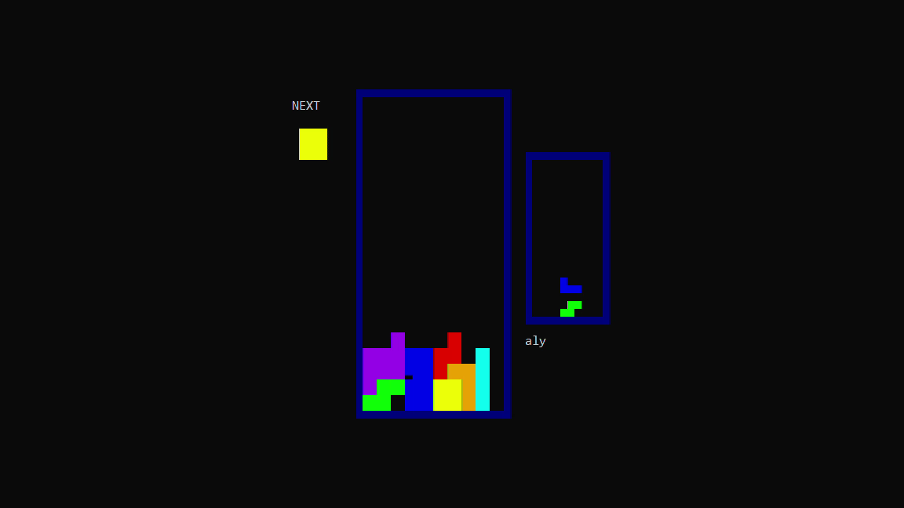
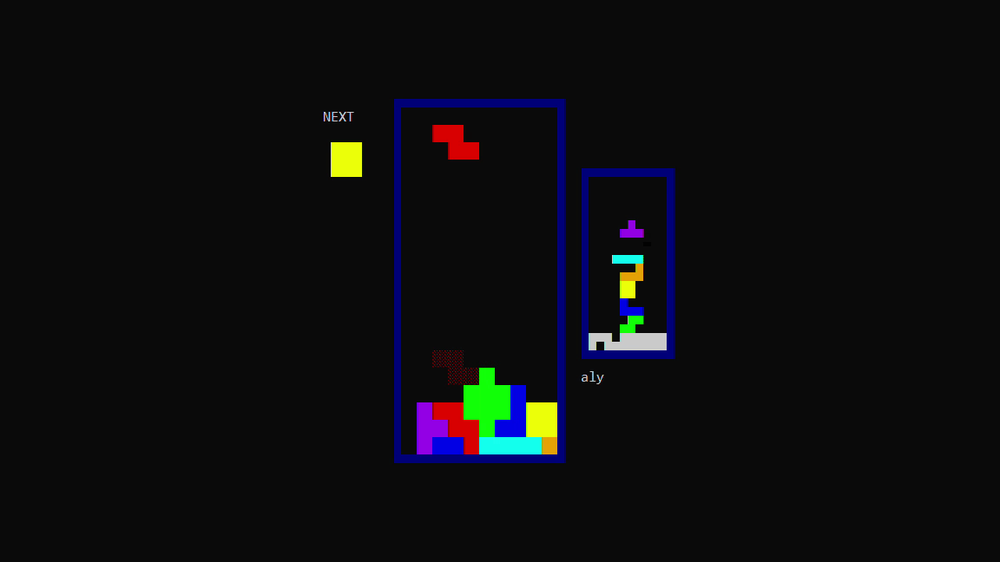

<p align="center"> <picture>  </picture> </p> <h3 align="center" style="font-family: monospace;"> Multiplayer battle-royale Tetris in your terminal! </h3> <br>

## Navigation
1.  [Features](https://github.com/alyshukry/console-tetris#features)
2.  [Try it out](https://github.com/alyshukry/console-tetris#run-it)
3.  [Demos](https://github.com/alyshukry/console-tetris#demos)
4.  [Architecture](https://github.com/alyshukry/console-tetris#architecture)
## Features
A real-time multiplayer Tetris battle played entirely in a terminal UI. Clear lines to send garbage to your opponents and be the last one standing. Built with Python, FastAPI, and WebSockets, with a server-authoritative game engine, client-side prediction with reconciliation, JWT auth, and PostgreSQL. Containerized with Docker and deployed on Render.
> The console-only UI is a deliberate choice. The point of this project is the backend: concurrency, real-time sync, auth, and deployment, rather than frontend polish.
## Try it out
1. Download the executable for your OS from the [releases page](https://github.com/alyshukry/console-tetris/releases) and run it on two devices (or twice with different accounts).
2. Register a new account.
3. Create a room on one of the devices (or accounts).
4. Join the room from the other device.
## Demos




## Architecture
```
  ┌────────────┐   HTTP (auth, room list)  ┌────────────────────────────┐   ┌────────────┐
  │  Terminal  │ ────────────────────────> │  FastAPI                   │ ─>│ PostgreSQL │
  │  client    │                           │  ├─ REST routes            │   └────────────┘
  │ (curses +  │   WebSocket (game)        │  ├─ WebSocket endpoint     │
  │  asyncio)  │ <───────────────────────> │  └─ Game engine (per room) │
  └────────────┘                           └────────────────────────────┘

```
-   **Game engine:** each room runs its own asyncio task, ticking at 15 ticks per second. Inputs, gravity, locking, line clears, and garbage are all resolved on the server.
-   **Prediction and reconciliation:** the client applies your moves locally right away and keeps a list of unacknowledged inputs. When the server's authoritative state arrives, the client rewinds to it and replays any inputs the server hasn't processed yet.
-   **Auth:** passwords are hashed with Argon2, and sessions use short-lived JWT access tokens with refresh tokens. The WebSocket handshake is authenticated with the access token.
-   **Concurrency:** many rooms run side by side on one event loop. Blocking work such as DB access is moved off the loop so ticks stay steady.
-   **Client:** a single asyncio event loop runs the render, input, receive, ping, and gravity loops. Menus are data-driven and reused in-game, such as the lobby and results screens.
